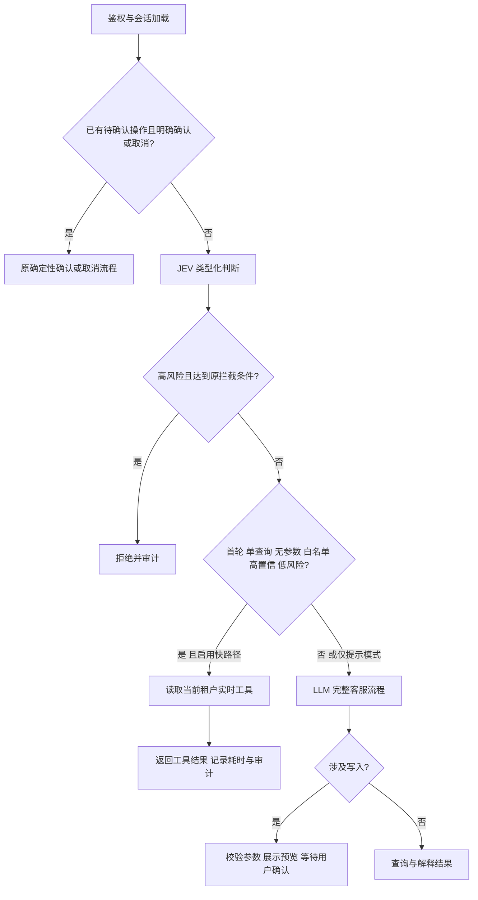

# JEV 高置信查询快路径：实现与评测

这次把 JEV 从“给 LLM 提示意图”升级为一条有边界的直接执行路径。首次独立查询通过 JEV 意图、查询形态、合法性和风险校验后，服务端调用当前租户的只读工具，直接返回实时结果；不再让 LLM 先选工具、再组织结果。其他请求保留完整客服流程。

## 首版边界

| 工具 | 直接执行的范围 |
|---|---|
| `get_balance` | 当前本人现金余额 |
| `get_consumption` | 默认近七天消耗 |
| `list_plans` | 全部套餐目录 |
| `get_my_subscription` | 当前本人订阅 |

意图和 `route_shape` 的置信度均至少 0.90；合法性概率至少 0.85；风险分小于 0.5、风险置信度至少 0.80。所有概率必须有效，类型和原始 JSON 必填字段必须完整；`choice`/`score` 不能借用 `noul` 字段的概率。JEV 不可用、字段异常、低置信、已有历史或待确认操作都回退。工具必须存在且不是确认型写工具。

复合任务、否定、写入、指定时间/筛选等请求只会被执行层排除，不由关键词选中一个工具。额度/配额等可能混淆现金余额与订阅资源的说法也强制回退。租户身份继续来自服务端鉴权；快路径执行与审计使用相同租户。工具失败保持 HTTP 500、保留 trace 与真实遥测，不伪造成功。

开关为 `JEV_FAST_PATH=1`、`JEV_FAST_PATH_MIN=0.90`。代码默认关闭快路径；提示组和快路径组提交相同四类 JEV 问题，只有是否直接执行的开关不同。无 JEV 组完全不调用 JEV。充值、退款、订购、改套餐、退订继续走参数校验和用户确认。

## 计量与复现

新增每轮实际 JEV/LLM/工具耗时、意图与查询形态置信度、合法性与风险分值、接受/回退原因、实际 LLM 尝试数及输入/输出/缓存 token。JEV 同样保存官方返回的输入/输出 token。缺失保持缺失，失败和重试的真实尝试计入分母与用量；HTTP 错误响应也保存这些字段。

原始 1,200 正常 + 20 对抗案例完整保留，另外运行 24 个冻结多轮任务，涵盖必要追问、补槽、预览、确认、取消、幂等与已满足状态。正常请求首工具命中是路由诊断，独立账本/订阅/订单状态核验才构成多轮任务完成。必要追问不算错误，正确回答后的可选服务提示与阻塞原任务的额外追问分别复核。

三组均使用相同源码、二进制、模型、数据集和并发；时间与成本另按相同案例 ID 比较快路径子集。费用是用实际 usage 和保存的峰/谷单价分别估算，包含 JEV；不是账单费用。单次全量并行运行仍受上游负载、缓存和采样影响，不能声称稳定因果收益或生产 SLA。开发与故障回归集没有变成独立盲测集，后续需要新增盲测和重复全量实验。

运行脚本：`scripts/run-agent-experiment.ps1` 与 `scripts/run-task-experiment.ps1`；比较工具：`eval/efficiency-review/analyze.py` 与 `analyze_tasks.py`。所有输出使用新目录，冻结脚本同时校验凭证不被归档，保存原字节与压缩字节 SHA256。

## 本轮真实故障与修复

初版源码 `f83b649` 的全量快路径接受 151 条，149 条首工具命中、2 条错路由，选择性路径正确率为 98.68%。错误是“剩余额度”和“我的额度还有多少没用”：原金标为订阅资源，JEV 却以 0.97 置信度判断为现金余额。这个结果保留在初版报告中，不把模型置信度称作真实正确概率。

修复按测试驱动流程增加中英文额度歧义回退；它减少可直接执行的范围，允许完整客服处理不确定语义，既没有把错例的金标硬编码成选工具规则，也没有降低置信度阈值。最终产品源码为 `f2b62e5`，完整 Go 测试与 vet 已通过，评测分析器的 24 项 Python 回归已通过。最终真实复验数据与其源提交绑定，另行冻结，不用初版数字冒充修复后结果。

## 最终观测与未完成项

最终首次全量实际执行1,220例，正常快路径142条（覆盖11.83%），142条首工具均命中且LLM调用为0。首次全量出现429限流（DeepSeek并发上限因剩余额度降至5），提示组末段还出现402余额不足；低并发补测仍以402失败，三个全量组分别保留97、107、97个HTTP失败，不能声称全量零失败。Key仍有效，错误来自模型账户余额；全量费用因错误响应usage缺失不可评估。

三组均成功且usage完整的相同107条，平均端到端响应1.867秒→0.484秒，谷价情景下包含JEV的估算费用降低69.31%。另外35条接受请求不进入该匹配费用/耗时子集，原始分母和排除ID全部保留。初版无429全量对照的净费用仍比无JEV更高，当前收益限于高置信子集，不能写成整体净降本。必要追问与状态核验的最终三组24任务均为24/24；两个快路径读取任务省去4次LLM调用。

完整过程、失败原因、峰/谷价假设、逐条追问复核与原字节校验见[冻结实验](../eval/experiments/2026-10-08-jev-fast-path/README.md)。充值后还需以账户允许的总并发重跑完整在线复验；后续应加入冻结盲测、阈值校准、问题输入压缩和覆盖率优化。旧报告的安全短路计数与新增业务快路径计数分开解释，不修改旧指标。
